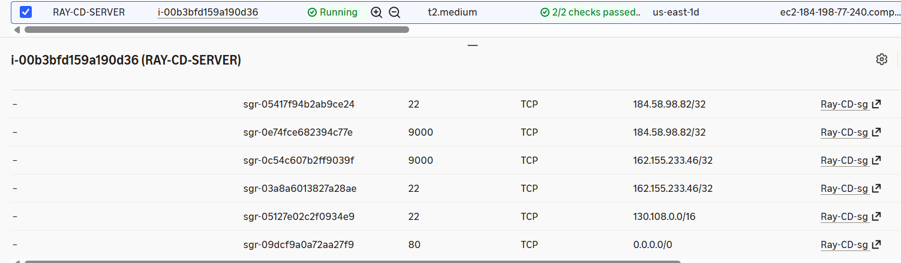

# CEG 3120 Project 7 - Continuous Deployment

## Project Overview

## Part 1 - Script a Refresh

### EC2 Instance Details

For this project, I created an AWS EC2 instance to host Akuma Fitness website using Docker. 

The instance was created manually through the AWS EC2 Console using this configuration

| Setting | Configuration |
| --- | --- |
| Instance Name | RAY-CD-SERVER |
| Operating System | Ubuntu Server 26.04 LTS |
| Instance Type | t2.medium |
| Storage | 30 GiB gp3 |
| Elastic IP | 184.198.77.240 |
| Security Group | Ray-CD-sg |

An Elastic IP was allocated and associated to create a consistent IP address. This will allow webhooks to be sent to the same address.

### Security Group Configuration

The security group Ray-CD-sg was created to control the connections reaching the EC2 instance.

| Port | Source | Purpose |
| --- | --- | --- |
| 22 | 184.58.98.82/32 | SSH access for Home |
| 22 | 168.155.233.46/32 | SSH access for Work |
| 22 | 130.108.0.0/16 | SSH access from Wright State |
| 80 | 0.0.0.0/0 | Public access to the website |
| 9000 | 184.58.98.82/32 | Webhook testing Home |
| 9000 | 162.155.233.46/32 | Webhook testing Work |

SSH was restricted to prevent unauthorized remote access. The project specifically calls for home and wright state, I included work as well since I do a lot of schoolwork while at work.

Port 80 allows the website to be accessed publicly.

Port 9000 is reserved for webhook testing as defined by the project.

## Part 2 - Webhook Listener

## Part 3 - GitHub Webhook

## Testing and Proof

 

This screenshot shows the instance built and running, as well as, the inbound security group rules created for this instance.

## References