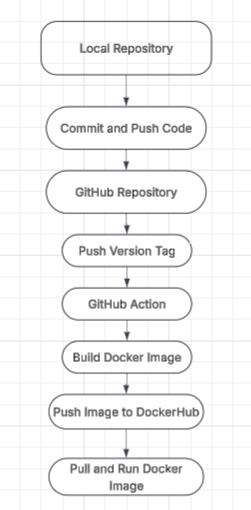
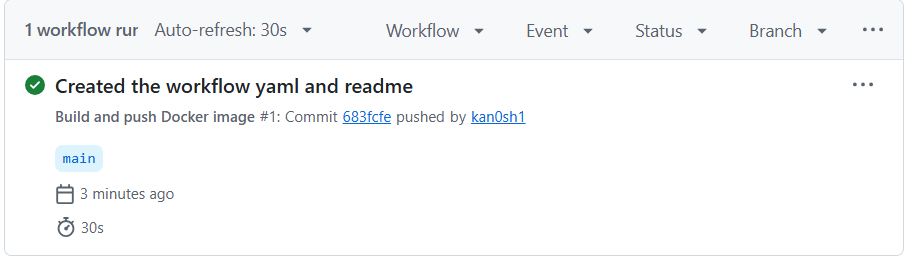
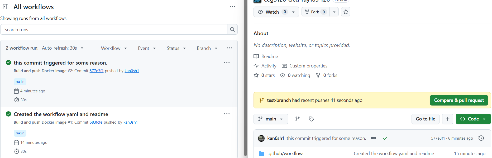
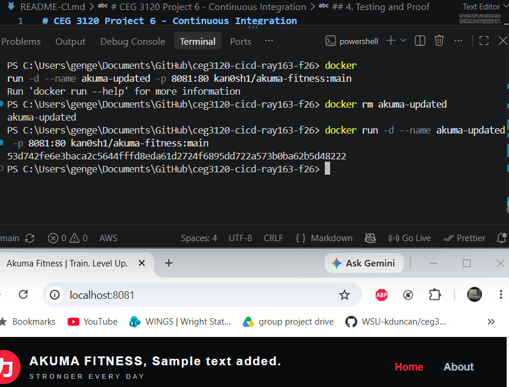
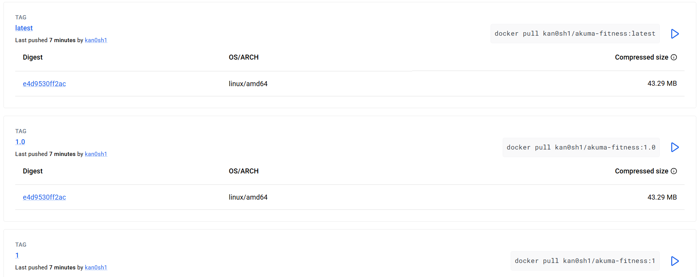
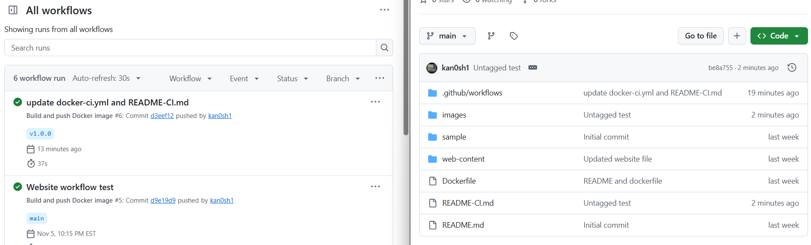
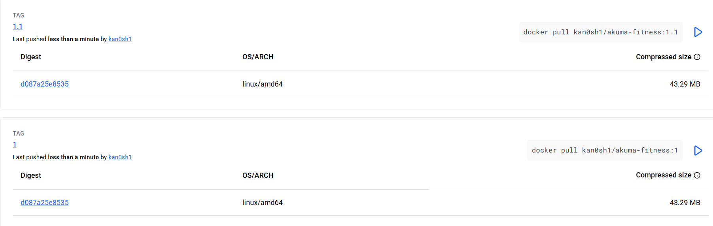
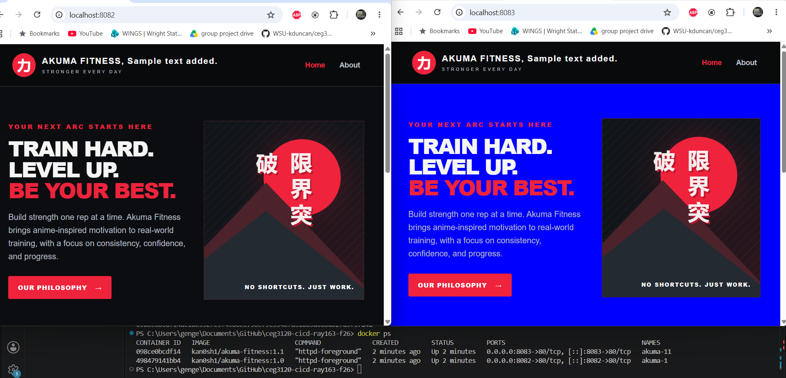

# CEG 3120 Project 6 - Continuous Integration
## Project Overview
### Project Goal
The goal of this project is to set up a Continuous Integration (CI) workflow using the GitHub Actions and DockerHub. The workflow will automatically build and publish a Docker Image containing my Akuma Fitness website when the triggering Git event occurs.

The project started by building and uploading Docker Images manually. GitHub Actions were configured to automate this process when changes were pushed to the main branch. In the end the workflow was updated to use semantic versioning so the Docker Image would only be pushed when a versioned tag was pushed.

### Tools Used
- Git: Used to track changes to the site and create versioning tags. 

- GitHub: Repository storing the website files, Dockerfile, Readme, and GitHub Actions workflow.

- GitHub Actions: Automates building and publishing the Docker Image. 

- Docker: Builds the website image and runs the container for testing. 

- DockerHub: Stores the published Docker image and the versioned tags.

- Apache HTTP Server: Runs the website from inside the Docker container.

### CI Workflow Diagram


The diagram shows how website files move from my local repository to DockerHub using Git Action.

To achieve this I make changes on my local machine and push them to the GitHub Repository. When I create and push a version tag, GitHub actions run the workflow to build and publish the Docker image. 

This image is then stored on DockerHub where it can be pulled and ran in a container. 

## 1. Docker Website and Container
### Website Files
For this project Akuma Fitness website was reused from earlier project. The website was generated with ChatGPT using this prompt: 

- I need two simple html pages and a css file. Create these for me and make them themed around an anime inspired gym.

This created three files:

- [index.html](web-content/index.html)

- [about.html](web-content/about.html)

- [style.css](web-content/style.css)

### Dockerfile
The Dockerfile is created in the root of the repository to build the website container using Apache HTTP Server.

```dockerfile
FROM httpd:2.4

COPY web-content/ /usr/local/apache2/htdocs/

```
FROM instruction comes from the official Apache HTTP server image. COPY is used to move the website files into the default directory that Apache uses to serve web content. 

### Building the Docker Image
After creating the Dockerfile, I built the Docker image from the repository using:

```bash
docker build -t kan0sh1/akuma-fitness:latest .

```
The docker build command uses the Dockerfile to create the image. The `-t` option assigns a name and a tag to the image, and the `.` tells Docker to use the current directory for the build context.

### Running the Docker Container
From the image I started a container to verify it was building and working correctly:

```bash
docker run -d --name akuma-ci-test -p 8080:80 kan0sh1/akuma-fitness:latest

```
The `-d` option runs the container in the background and `-p 8080:80` maps 8080 from my computer to port 80 inside the container.

`docker ps` was used to verify the container was running. I opened `localhost:8080` to verify that the image built and was running the website correctly.

### Pushing the Image to DockerHub
DockerHub repository was reused from previous project. After building and testing the image locally, log into DockerHub using a Personal Access Token.

```bash
docker login -u kan0sh1

docker push kan0sh1/akuma-fitness:latest

```
The docker push command uploads the image to DockerHub repository with the latest tag.

DockerHub was checked to verify the image was uploaded successfully.

[Akuma Fitness DockerHub Repository](https://hub.docker.com/r/kan0sh1/akuma-fitness)

## 2. GitHub Actions and DockerHub
### Creating a DockerHub PAT
For GitHub Actions to publish a Docker image, a PAT is needed in DockerHub.

To create the token:

1. Sign into DockerHub and open the Account Settings.

2. Select Personal Access Tokens.

3. Select Generate New Token

4. Give the token a meaningful name and select its permissions. 

5. Generate the token and copy it into a secure location.

The recommended permissions for this project were Read & Write. This allows the GitHub action to authenticate with DockerHub and push images while limiting other features.

### GitHub Repository Secrets
To allow GitHub Actions to upload Docker Images to DockerHub, two repository secrets were configured.

- **DOCKER_USERNAME:** stores my DockerHub username.

- **DOCKER_TOKEN:** stores my DockerHub Personal Access Token.

These are easily added by going to GitHub repository:

- Choose settings

- Secrets and Variables

- Actions 

- New Repository Secret

**Important:** Never save a PAT or password in a public repository.

### GitHub Actions
For this portion of the project, a YAML was created from the official Docker Documentation to create my GitHub Actions workflow. Changes were made to the example document to match my existing DockerHub Repository.

The initial workflow uses `on: push` with the main branch specified. This means the workflow will only start when the changes are pushed to main. 

The YAML was updated later in the project to only start the workflow when a tagged version was created.

The `contents: read` permission allows the workflow to read the repository contents without giving extra permissions.

Docker/metadata-action@v6 action generates the tags and metadata used for the Docker image. The image name was changed from the example template to match the DockerHub repository. Since the username is saved in a secret file on GitHub I carried that styling over and kept the username secret by using a secret call defined from the documentation. The metadata action uses default tagging rules, generating branch based tags when the workflow runs.

Docker/login-action@v4 action signs into DockerHub using the DOCKER_USERNAME and DOCKER_TOKEN repository secrets. By using these secrets the workflow can authenticate without putting my credentials directly into the YAML file or having them saved in the public on GitHub. 

The `docker/setup-buildx-action@v4` action sets up Docker Buildx, which is used by Docker to build the container image. 

The `docker/build-push-action@v7` action builds the image using the Dockerfile in my repository and uploads it to DockerHub. 

The `push: true` setting tells the action to upload the image to DockerHub after it has been built. The tags, labels, and annotations will then be supplied by the metadata action also configured in the workflow.

### Reusing the Workflow
To take this workflow and use on another project, some values need modified.

GitHub Actions Workflow:

The Images value in the docker/metadata-action would need to match the appropriate DockerHub username and image as opposed to, kan0sh1/akuma-fitness.

The branch trigger should be updated for the desired image build if the user wanted a different trigger.

GitHub Repository:

The DOCKER_USERNAME secret would need to contain the appropriate DockerHub username.

The DOCKER_TOKEN secret would need to contain the appropriate DockerHub PAT.

The repository would need a Dockerfile and the website files in the correct location for their image to build.

### Part 2 Permalink: https://github.com/WSU-kduncan/ceg3120-cicd-ray163-f26/commit/683fcfe829641385764a90d274be5677599cd0bf
This is the commit containing the original GitHub Action workflow that was configured to build and push Docker images when changes were pushed to the main branch. This is the commit for the workflow prior to the semantic versioning update. 

### Testing the Workflow
To test the GitHub Actions workflow, I made a small change to my website and committed it to the main branch.

The changes were pushed using 

```bash
git push origin main

```
Opening the actions tab in GitHub repository after this found the workflow to be running. I waited for the workflow to finish and verified that it ran successfully. Checking DockerHub after found the image was published and updated.

To test the Docker image locally you can pull it from DockerHub:

```bash
docker pull kan0sh1/akuma-fitness:main

```
I started the container using the downloaded image:

```bash
docker run -d --name akuma-updated -p 8081:80 kan0sh1/akuma-fitness:main

```
After starting the container you can call docker ps to verify the image is running and open http://localhost:8081 in the browser.

The updated website displayed correctly, which confirmed the GitHub action built and published the changes successfully.

I also tested a separate branch commit. Given the way the YAML was set up a push on any branch other than main should not have triggered a workflow. It did not which confirmed the workflow was restricted correctly. 

## 3. Semantic Versioning
To start the semantic versioning, The GitHub action trigger was changed from pushes to main branch to pushes containing versioning tags. 

The branch filter was replaced with v*.**.** so the workflow would run when i pushed version tags. This allows Docker images to be published when a versioned release was made instead of every update to the website. 

### Creating Git Tags
After the workflow was updated to allow semantic versioning, the changes were committed and pushed to the main branch. 

An annotated Git tag was created named v1.0.0 using git tag -a command. This tag was used for the first full release of the website. The tag was pushed to GitHub using git push origin v1.0.0 which triggered the GitHub action workflow to build and publish the Docker Image. 

### Git Tag Commands
Git tags were used to identify specific releases of the website. I used annotated tags to mark the versions that would trigger GitHub Actions.

To view existing tags in the repository:

```bash
git tag -l

```
To create a versioned tag:

```bash
git tag -a v1.0.0 -m "Full Version Release"

```
The `-a` option creates an annotated tag, while `-m` provides a message describing the release.

To push the tag to GitHub:

```bash
git push origin v1.0.0

```
This process is easily mimicked for further versioned updates. Simply change the version tag and push the new tag to GitHub. 

In doing this variation the website versions are all accessibly from DockerHub under the appropriate version tags.

### Docker Image Version Tags
The Docker metadata action to generate image tags based on semantic version was updated. This update would allow the image to have the latest, major version, and major.minor version tags.

The semver patterns from [Dockers Manage Tags and Actions](https://docs.docker.com/build/ci/github-actions/manage-tags-labels/) page was utilized. The `{{major}}` tag generates the major version, while `{{major}}.{{minor}}` generates the major and minor versions together. 

The raw latest tag allows the newest release to be identified without specifying a version number. 

So, for example, pushing Git tag v1.2.5 would create Docker image tags 1, 1.2 and latest. 

### Docker Image Tags
After pushing the v1.0.0 Git tag, the GitHub Actions workflow should trigger. Checking the DockerHub repository verified that the workflow successfully published the image with latest, 1, and 1.0 tags. 

### Semantic Versioning Configuration
The GitHub actions workflow was updated to publish Docker images when a version tag matching the v*.**.** was pushed instead of on every commit to main.

The workflow used these steps:

1. docker/metadata-action: Generates Docker image tags based on the Git version tag. The configured patterns produce the major version, major.minor version, and the latest tags.

2. docker/login-actions: Authenticates with DockerHub using the DOCKER_USERNAME and DOCKER_TOKEN repository secret. 

3. docker/setup-buildx-action: Prepares Docker Buildx to build the container image.

4. docker/build-push-action: Builds the image using the Dockerfile and publishes it to the DockerHub with the generated tags.

### Testing and Validating Semantics
To test the updated workflow, I pushed the annotated Git tag v1.0.0 to GitHub. I opened the GitHub Actions tab and verified the workflows ran and completed successfully. 

Checking DockerHub repository found the image was published with the latest, 1, and 1.0 tags. 

After making a change to the website, in the way of background color, I created and pushed the v1.1.0 tag. This triggered another successful workflow and updated the latest tag. The previous 1.0 image remained visible on the DockerHub site as well.

To verify the images worked, I pulled both versions:

```bash
docker pull kan0sh1/akuma-fitness:1.0

docker pull kan0sh1/akuma-fitness:1.1

```
Both versions were ran on separate ports:

```bash
docker run -d --name akuma-10 -p 8082:80 kan0sh1/akuma-fitness:1.0

docker run -d --name akuma-11 -p 8083:80 kan0sh1/akuma-fitness:1.1

```
`docker ps` was ran to confirm both containers were running and opened `localhost:8082` and `localhost:8083` in the browser.

Both versions displayed their website content with changes. This confirmed that the newer image was published correctly and the older releases could still be used for rollback.

## 4. Testing and Proof


Creating and running the Docker image. This was a test to show that the container was running as intended.


This screenshot shows the GitHub Secrets page with my username and token secret added in. The content of those fields is hidden in the screenshot.



Screenshot showing the YAML workflow successfully created a workflow in the GitHub actions.



To verify that the workflow only ran with main branch, I created a test branch. A small sentence was added to the bottom of the README, it was then committed and pushed to GitHub. I refreshed the page and verified that no new workflow was triggered by this push. This shows that the YAML restriction is built and working as intended.



To test if the workflow was publishing website updates, I made a small visible change to the index.html file and pushed the changes to the main branch. The push triggered another action run. After the workflow completed successfully, i pulled the updated docker image using the main tag. 

A new container was started using the updated image and i opened the website in my browser. The changes appeared correctly confirming the updated website files were pushed to Docker Successfully.



This screenshot shows that the updated versioning pushed to DockerHub successfully and generated all 3 expected tags.



This screenshot shows that after a successful commit the workflow action did not trigger due to the yaml file



This screenshot shows the versioning update works and now displays v1 as well as v1.1



This screenshot shows that the image can be pulled from a previous release version. v1.1 and v1.0 were both ran simultaneously on different ports so they could be compared side by side. `docker ps` is included under the websites to show the semantic versioning of the images.

## References
- [DockerHub httpd](https://hub.docker.com/_/httpd) - Docker website with instructions on how to use Apache.

- [GitHub Docs: Repository Secrets](https://docs.github.com/en/actions/how-tos/write-workflows/choose-what-workflows-do/use-secrets) - Shows how to add repository secrets into the GitHub Repository

- [DockerDocs GitHub Actions](https://docs.docker.com/build/ci/github-actions/) - Gives a YAML file showing how to set up the CI pipeline.

- [GitHub Workflow Syntax](https://docs.github.com/en/actions/reference/workflows-and-actions/workflow-syntax) - Shows how workflows are structured giving a better understanding of what the parts of the YAML were doing and why.

- [Docker Metadata](https://github.com/docker/metadata-action) - Shows how metadata action generates tags. 

- [Docker Tags](https://docs.docker.com/build/ci/github-actions/manage-tags-labels/) - action workflow for versioning explanations. and updates to the yaml to create versioning pushes 

- [Git Tagging](https://git-scm.com/book/en/v2/Git-Basics-Tagging) - how to annotate a tag and push to the repository

### AI Assistance Disclosure

- [Chat GPT](https://chatgpt.com/) - Used to format and proofread this README. Chat GPT also used to create the Akuma Fitness website files.
    - Prompt: format this markdown into a nice looking document. Ensure that fenced brackets are working. Leave my general tone in the document. You can trim excess wording where applicable.
