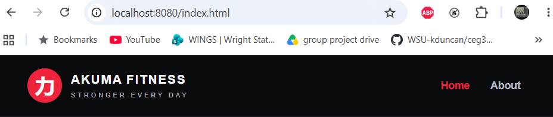
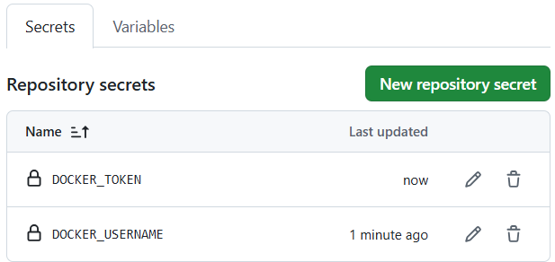

# CEG 3120 Project 6 - Continuous Integration

## Project Overview

### CI Workflow Diagram

## 1. Docker Website and Container

### Website Files

For this project Akuma Fitness website was reused from earlier project. The website was generated from ChatGPT, using prompt: 

- I need two simple html pages and a css file. Create these for me and make them themed around an anime inspired gym.

This created three files:

- [index.html](web-content/index.html)

- [about.html](web-content/about.html)

- [style.css](web-content/style.css)

### Dockerfile

The Dockerfile is created in the root of the repository to build the website container using Apache HTTP Server.

```
FROM http:2.4
COPY web-content/ /user/local/apache2/htdocs/
```

FROM instruction comes from the official Apache HTTP server image. COPY is used to move the website files into the default directory that Apache uses to serve web content. 

### Running the Docker Container

From the image I started a container to verify it was building and working correctly:

```
docker run -d --name akuma-ci-test -p 8080:80 kan0sh1/akuma-fitness:latest
```

The -d option runs the container in the background and -p 8080:80 maps 8080 from my computer to port 80 inside the container.

Docker ps was used to verify the container was running. I opened localhost:8080 to verify that the image built and was running the website correctly.

### Pushing the Image to Dockerhub

Dockerhub reppsitory was reused from previous project. After building and testing the image locally, log into Dockerhub using a Personal Access Token.

```
docker login -u kan0sh1
docker push kan0sh1/akuma-fitness:latest
```

The docker push command uploads the image to DockerHub respository with the latest tag.

Dockerhub was checked to verify the image was uploaded successfully.

[Akuma Fitness DockerHub Repository](https://hub.docker.com/r/kan0sh1/akuma-fitness)

## 2. Github Actions and Dockerhub

### Github Repository Secrets

To allow GitHub Actions to upload Docker Images to DockerHub, two respository secrets were configured.

- DOCKER_USERNAME: stores my DockerHub username.

- DOCKER_TOKEN: stores my DockerHub Personal Access Token.

These are easily added by going to Github repository:

- Choose settings
- Secrets and Variables
- Actions 
- New Repsitory Secret

***It is important to never save a PAT or Password in a repository where anyone else could see this personal information.***

## 3. Semantic Versioning

## 4. Testing and Proof



Creating and running the Docker image. This was a test to show that the container was running as intended.



This screenshot shows the GitHub Secrets page with my username and token secret added in. The content of those fields is hidden in the screenshot.


## References

- [Dockerhub httpd](https://hub.docker.com/_/httpd) - Docker website with instructions on how to use Apache.

- [GitHub Docs: Respository Secrets](https://docs.github.com/en/actions/how-tos/write-workflows/choose-what-workflows-do/use-secrets)